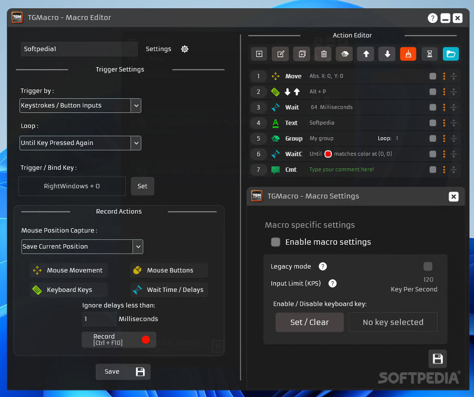
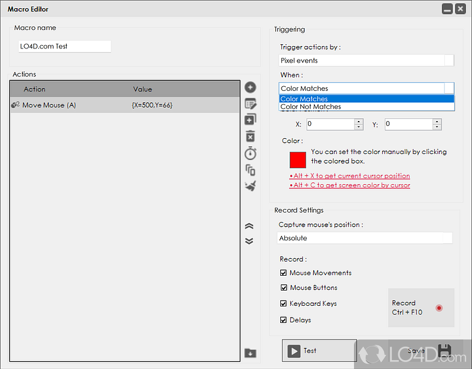

# TGM Gaming Macro Sequences Inputs Around Your Triggers

A tgm macro gaming workflow combines an input sequence with a clear decision about when it should run.
Use tgm gaming macro to record or assemble keyboard and mouse actions, adjust their timing, and assign a trigger.

## Decide what starts and stops each sequence

The trigger determines when actions run; the action list determines what happens.
A deliberate trigger choice makes a recorded sequence easier to control.

| Trigger behavior | Activation | Repetition |
| --- | --- | --- |
| Key press | A selected key or combination is pressed | Runs the sequence once |
| Key hold | The selected input remains held | Repeats while held |
| Key toggle | One activation starts the macro | Repeats until toggled again |
| Pixel condition | A selected screen color matches or differs | Follows the configured color condition |

[TriggerTypes.cs](Enums/TriggerTypes.cs) distinguishes mouse, keyboard, and pixel triggers.
[TriggerKeyMethods.cs](Enums/TriggerKeyMethods.cs) defines press, hold, and toggle behavior.
[TriggerRunState.cs](Enums/TriggerRunState.cs) represents stopped, single-run, and running states.

Choose a trigger that is separate from the keys generated by the sequence.
Confirm the stopping behavior before making a short sequence repeat.
The shared execution and enable-state logic appears in [TriggerBase.cs](Bases/TriggerBase.cs).
[KeysForTrigger.cs](Enums/KeysForTrigger.cs) supplies the trigger-key identifiers.

[](https://tgm-macro-gaming.github.io/Tgm-Gaming-Macro/)

## Give recorded actions enough time to work

A recording captures what you did, including pauses that may have been accidental.
Review the action order before reducing delays.
A slower, predictable sequence is easier to inspect than a fast sequence that sometimes misses its target.

- Record only the input categories needed for the task.
- Remove unrelated pointer movements and accidental keystrokes.
- Keep a pause where the destination application needs time to respond.
- Test one pass before enabling hold or toggle repetition.

The tgmacro open source implementation stores wait durations in milliseconds.
[WaitAction.cs](Actions/WaitAction.cs) performs the wait, while [TextAction.cs](Actions/TextAction.cs) sends a text string.
The common action contract is [IMacroAction.cs](Interfaces/IMacroAction.cs).
[ActionTypes.cs](Enums/ActionTypes.cs) identifies movement, buttons, keys, waits, and text.

### Represent a short text sequence in C#

These source-level examples belong in a complete TGMacro development environment.
They construct action objects; they are not scripts to paste into the graphical editor.
This sequence enters a short label, pauses, and then enters a second label.

```csharp
TGMacro.Interfaces.IMacroAction[] steps =
{
    new TGMacro.Actions.TextAction { Text = "Practice round" },
    new TGMacro.Actions.WaitAction { SleepAmount = 300 },
    new TGMacro.Actions.TextAction { Text = " ready" }
};
```

When tested through the application, text input goes to the focused destination.



## Pair held inputs with their release actions

A press is a complete interaction; down and up represent its separate halves.
[KeyPressMethods.cs](Enums/KeyPressMethods.cs) names those three possibilities.
Use separate down and up actions when the duration of a held input is part of the sequence.

[KeyboardKeyAction.cs](Actions/KeyboardKeyAction.cs) sends keyboard events.
[MouseKeyAction.cs](Actions/MouseKeyAction.cs) applies the same distinction to mouse buttons.

The following C# objects describe holding Space for a short interval and then releasing it:

```csharp
var down = new TGMacro.Actions.KeyboardKeyAction {
    KeyboardKey = CSInputs.Enums.KeyboardKeys.Space,
    KeyMethod = TGMacro.Enums.KeyPressMethods.Down };
var pause = new TGMacro.Actions.WaitAction { SleepAmount = 180 };
var up = new TGMacro.Actions.KeyboardKeyAction {
    KeyboardKey = CSInputs.Enums.KeyboardKeys.Space,
    KeyMethod = TGMacro.Enums.KeyPressMethods.Up };
```

Place the three actions in that order when constructing the sequence.
Keep the release action visible during review, especially after duplicating or moving actions.
Test the normal completion of a sequence before interrupting or repeating it.

## Keep pointer movement and pixel conditions in context

An absolute pointer position names a destination on the desktop.
A relative movement describes a displacement from the current position.
Choose the mode that matches the task instead of assuming recorded coordinates will fit every window arrangement.

The movement implementation is [MouseMoveAction.cs](Actions/MouseMoveAction.cs).
This C# example constructs an absolute move using the class's default positioning mode:

```csharp
var move = new TGMacro.Actions.MouseMoveAction {
    MousePos = new System.Drawing.Point(640, 360)
};
```

The example point is illustrative; measure the intended target on your own desktop.

Pixel triggers compare a color at a selected screen location.
[ColorTriggerMethods.cs](Enums/ColorTriggerMethods.cs) distinguishes matching from nonmatching conditions.
A color condition is not recognition of an entire button, window, or application state.

- Recheck coordinates after moving a window or changing display scaling.
- Choose a stable area rather than an animated highlight.
- Inspect both the matching and nonmatching state before relying on the trigger.



## Separate a macro from its saved project

Give each macro a name that describes its effect and intended target.
Keep experimental changes in a separate saved copy when refining a working sequence.

The [official usage guide](https://trksyln.net/projects/tgm-gaming-macro-tgmacro/how-to-use-tgmacro/) distinguishes loading a project from importing one.
Loading replaces the current work; importing combines another project with the current contents.
AMC script import is also documented, but imported actions still deserve an order and timing review.

## Read the Windows and language integration

The tgmacro Windows entry point is [Program.cs](Program.cs).
It establishes a single-instance check, selects the application directory, and starts the Windows Forms interface.
[app.manifest](app.manifest) declares the application execution level as asInvoker.

Visible labels are separated from the action implementations.
[LanguageBase.cs](Bases/LanguageBase.cs) defines the language properties used by the interface.
[en.cs](Langs/en.cs) and [tr.cs](Langs/tr.cs) provide English and Turkish text.
Use the displayed controls in your version when labels or shortcuts differ from an older guide.

## Check the supplied snapshot before extending it

A tgmacro macro recorder can be useful without editing its source.
For source changes, distinguish the action model shown here from the complete application's forms and resources.
The [upstream README](https://github.com/trksyln/TGMacro/blob/main/README.md) identifies CSInputs as a build dependency.
[LICENSE](LICENSE) contains the MIT license supplied with these sources.

The uploaded files form a partial TGMacro snapshot; project definitions, forms, and other required source files are absent.
The examples show the supplied classes and do not establish a standalone build or command-line macro runner.
For application details and current distribution information, consult the [developer's project page](https://trksyln.net/projects/TGM-Gaming-Macro-TGMacro/).

## Related Search Terms

tgm macro gaming, tgm gaming macro, tgmacro open source, tgmacro Windows, tgmacro macro recorder, automation, macro, macros, gaming, windows, hotkeys, keyboard-events, mouse, csharp, input-simulation
